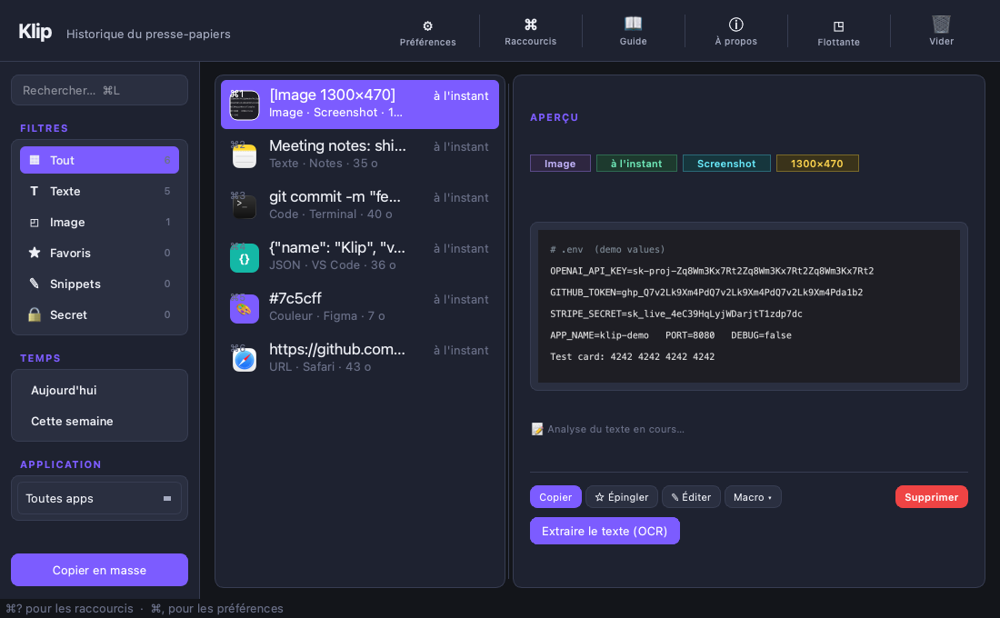
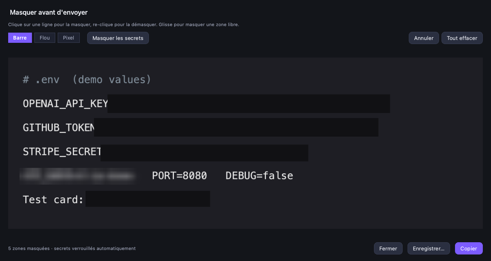

# Klip

**A clipboard manager for macOS that lets you hide API keys in a screenshot before you send it.**

Press `⌥⌘V` anywhere: your clipboard history appears, Spotlight-style. Pick an item, hit `↩`, and it is pasted straight into the app you were using.

The newest feature: before you paste a screenshot into Slack, an issue or a tweet, Klip can black out every API key, token, card number and IBAN it finds in it, automatically.



## Hide secrets in screenshots



- Open a screenshot in Klip and click **✎ Éditer** (`⌘E`).
- Click a line of text to hide it, click again to show it. Drag to hide any area (a face, a logo).
- Choose a style: **bar**, **blur** or **pixel**.
- **Masquer les secrets** blacks out every key the text recognition finds: OpenAI, Anthropic, GitHub, AWS, Stripe, Slack, Google, Notion, Hugging Face, JWT, private keys, card numbers (Luhn-checked), IBANs (checksum-checked), `password: …` values, and long random tokens.
- **Copy** or **Save**: the mask is burned into the pixels of the exported PNG. The original stays untouched in your history.

**Always-on mode.** In *Préférences › Confidentialité*, tick *Toujours masquer les secrets dans les captures d'écran*. From then on, any screenshot leaving Klip (copy, drag-and-drop, floating window) has its secrets covered with a solid bar. If the analysis fails, nothing is copied: Klip refuses rather than leaking.

Why a solid bar and not a blur for secrets: blurred or pixelated text can sometimes be reconstructed. Blur and pixel are there for looks, not for keys.

Under the hood: Apple's Vision framework for text and its position, a normalisation pass for OCR look-alikes (Cyrillic `А`, `—` read instead of `-`, `×` instead of `x`…) that would otherwise cut a key in half, and a safety margin so that no tail of a key can stay visible. Tested end to end by redacting, then re-reading the result with OCR: 72 keys in 4 fonts, zero characters leaked.

## Everything else

- **Native capture** in the background (`NSPasteboard.changeCount`), even when the window is closed
- **Auto-paste**: `⌥⌘V` → pick → `↩` → pasted into the previous app
- **OCR on images**: screenshots become searchable by their text
- **Secrets are never stored**: API tokens and private keys copied as text are kept out of the history; password-manager copies (`ConcealedType`) are ignored
- **Snippets and text expansion**: type `;sig` anywhere and your signature expands (opt-in)
- **Fuzzy search** ranked by frequency × recency × relevance
- **Filters** by type, date, source app, favourites, snippets
- **Smart actions** by content type: open a URL or strip its tracking parameters, format or minify JSON, colour swatch with RGB/HSL conversion, reveal a path in Finder, paste HTML as plain text…
- `⌘1`…`⌘9` to copy the n-th item, pinned favourites that are never purged
- **Instant capture** with `⌥⌘⇧S`, a floating mini-window, light and dark themes
- Local **SQLite** storage in `~/.clipboard_pro/`, deduplicated, with automatic retention you control. Nothing leaves your Mac.

## Install

**Download** the latest `.dmg` from [klip.humain01.com](https://klip.humain01.com) or the [releases](https://github.com/skillitny/klip-app/releases), open it and drag Klip into Applications. The first time, right-click Klip › Open.

Requirements: macOS on Apple Silicon (M1 and later). Intel Macs are not supported by the current build.

**Permissions.** The global shortcut and text expansion need *System Settings › Privacy & Security › Accessibility* and *Input Monitoring*. Without them Klip still works from its menu-bar icon.

## Build from source

```bash
git clone https://github.com/skillitny/klip-clipboard.git
cd klip-clipboard
python3 -m venv .venv
.venv/bin/pip install -r clipboard_pro/requirements.txt

# run from source
.venv/bin/python -m clipboard_pro.main

# build Klip.app + the DMG (py2app needs setuptools < 72)
./build_release.sh
```

Python 3.14, PyQt6 and PyObjC. The code lives in `clipboard_pro/`. The Windows port (`clipboard_pro/osbackend/windows.py`) is written but not yet released.

## Shortcuts

| Action | Shortcut |
|---|---|
| Open / close | `⌥⌘V` |
| Copy (and auto-paste) | `↩` |
| Copy the n-th item | `⌘1` … `⌘9` |
| Hide parts of a screenshot / edit text | `⌘E` |
| Pin | `⌘P` |
| Quick Look | `Space` |
| Instant capture | `⌥⌘⇧S` |
| Search | `⌘L` |
| Close | `Esc` |

## En français

Klip est un gestionnaire de presse-papiers pour macOS (interface en français). Il permet notamment de masquer les clés API, tokens, cartes bancaires et IBAN d'une capture d'écran avant de l'envoyer, à la main ou automatiquement. Téléchargement : [klip.humain01.com](https://klip.humain01.com).

## License

[MIT](LICENSE) © 2026 Yoni Sitbon
